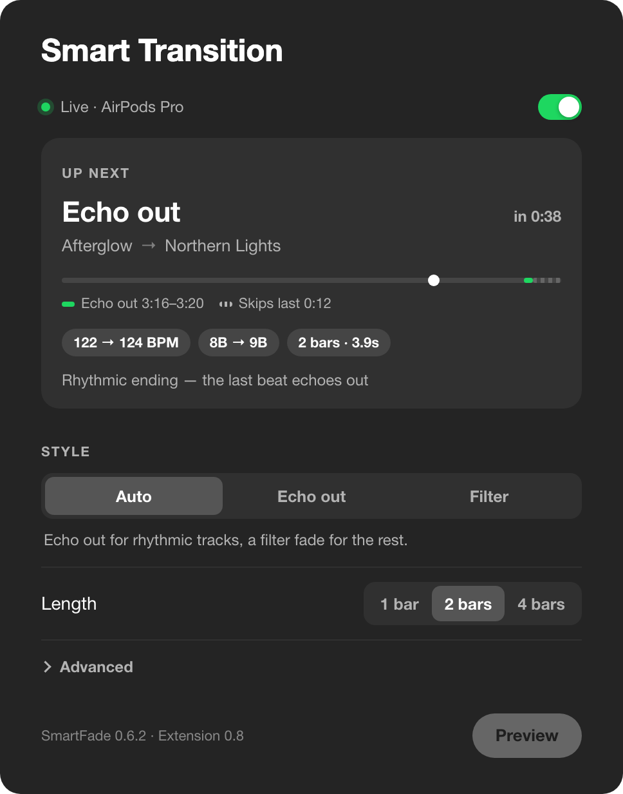

<p align="center">
  
</p>

<h1 align="center">SmartFade</h1>

<p align="center">Smooth transitions for Spotify on macOS.</p>

<br>

<picture>
  <source media="(prefers-color-scheme: dark)" srcset="assets/how-dark.svg">
  
</picture>

<p align="center">
  
</p>

## Install

Requires macOS 14.4+.

Install **spicetify**(https://github.com/spicetify/cli)
1. Install **SmartFade** and [**adblockify**](https://github.com/rxri/spicetify-extensions/tree/main/adblock) from the Spicetify Marketplace.
2. Download [SmartFade](https://github.com/stevia7896/smartfade/releases/latest), drag it to Applications and open it.


```sh
./build.sh
open build/SmartFade.app

cp extension/smartTransition.js ~/.config/spicetify/Extensions/
spicetify config extensions smartTransition.js
spicetify apply
```

</details>

<br>

<sub>MIT License.</sub>
